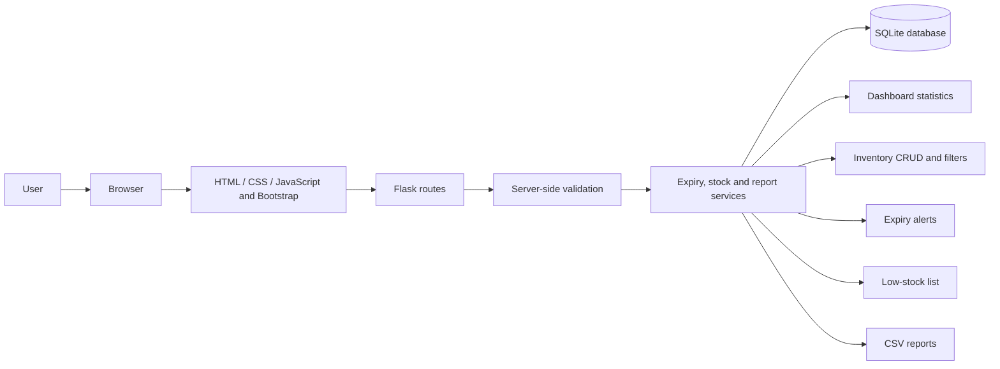
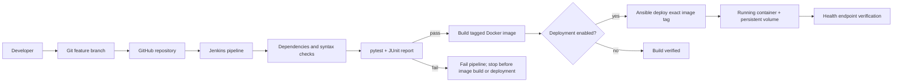

# Architecture and DevOps workflow

## Application runtime architecture

The browser renders responsive templates and submits forms. Flask validates input and uses parameterized SQLite operations. Business rules compute expiry and low stock from records. SQLite persists in the Docker named volume.

## DevOps delivery architecture

Jenkins checks out the source, runs syntax/config checks and pytest. A failure prevents image build and deployment. On success, Jenkins tags the image with the checked-out commit; Ansible receives that exact tag, updates the container while retaining its named data volume, and checks health. A public GitHub webhook requires an endpoint GitHub can reach.

## Component roles

| Component | Responsibility |
|---|---|
| Flask | Routes, forms, health and report endpoints |
| SQLite | Medicine batch records and indexes |
| pytest | Deterministic route, validation, date and CSV checks |
| Git/GitHub | Version history, branches and source collaboration |
| Jenkins | Test gate, image build and optional deployment orchestration |
| Docker | Repeatable image and persistent runtime volume |
| Ansible | Idempotent container deployment and health verification |

