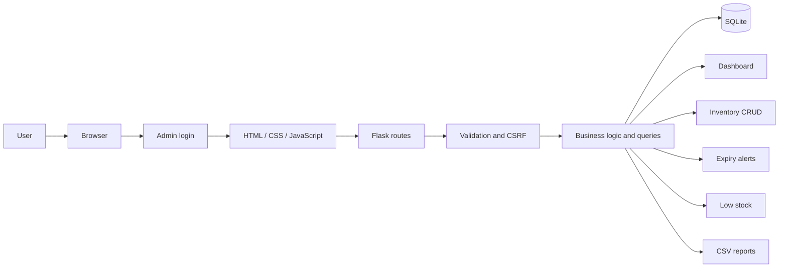
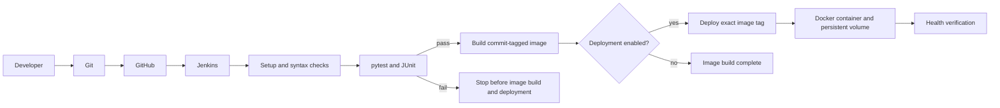

# Medicine Stock and Expiry Tracking System with DevOps Automation

## 23IT723 DevOps Laboratory — Mini Project Report

**Academic year:** 2025–2026 · **Project type:** Final mini project · **Prepared:** October 2026

> Add approved cover details, student/team names, register numbers, supervisor, and certificate signatures before submission. EcoDeploy was used only as an organizational reference; this report and application content are original.

## Abstract

Small pharmacies need accurate visibility into medicine batches, quantities, and expiry dates. Manual tracking can delay replenishment and make reporting difficult. This project implements a responsive Flask application backed by SQLite for batch management. It provides CRUD operations, search and filters, expiry classification, low-stock alerts, a live dashboard, and CSV downloads.

The project demonstrates delivery using Git/GitHub, Jenkins, pytest, Docker, and Ansible. Jenkins runs checks and tests before building an image; optional deployment passes its tag to Ansible, which updates a Docker container while retaining its SQLite data volume and checking health. The app works independently of Jenkins and Ansible.

## 1. Introduction and objectives

The system centralizes batch quantities, expiry dates, supplier details, and stock thresholds. It is an academic demonstration, not a certified pharmacy platform. It collects no patient details and makes no treatment decisions.

Objectives are to provide responsive inventory management, dynamic expiry and low-stock alerts, CSV reporting, persistent SQLite storage, automated pytest checks, and a test-gated delivery pipeline.

## 2. Requirements and technology

An administrator signs in before accessing the application. The public login page introduces MediStock and summarizes its features. The user can add, view, update, delete, search, filter, and sort medicine batches; review dashboard statistics; view expired, near-expiry, and low-stock records; and download inventory, expired, near-expiry, and low-stock reports. Server-side validation, CSRF, parameterized SQL, hashed admin passwords, and test database isolation support reliable operation.

| Layer | Technology |
|---|---|
| Interface | HTML5, CSS3, JavaScript, Bootstrap 5 |
| Application | Python Flask, Gunicorn |
| Storage | SQLite |
| Testing | pytest, JUnit XML |
| Version control | Git and GitHub |
| CI/CD | Jenkins Pipeline |
| Containers | Docker and Compose |
| Configuration | Ansible Core, community.docker |

## 3. Application design

### Runtime architecture

The medicines table stores a unique batch identifier, medicine name, category, manufacturer, non-negative quantity and threshold, ISO dates, decimal-formatted unit price, supplier, and timestamps. Indexes support expiry, stock, and name queries.

### Business rules

- Expired: expiry date is before today.
- Near expiry: today through today plus 30 calendar days, inclusive.
- Valid: more than 30 days remain.
- Low stock: quantity is less than or equal to its threshold.

A medicine remains valid through its recorded expiry date. Dates are configurable through a single injectable clock and expiry window.

### Modules

The dashboard calculates catalog counts, units, expiry groups, low-stock counts, recent records, and attention items from the database. Inventory offers search, filters, sorting, details, and edits. Expiry management retains expired records; low-stock management shows reorder information. CSV generation uses the standard CSV writer for quoting and escaping.

## 4. DevOps delivery workflow

Jenkins checks out source, validates syntax/configuration, runs pytest, publishes JUnit results, and builds only after test success. Deployment is opt-in. Ansible updates the container and preserves its named data volume; failure marks the pipeline failed. GitHub webhooks need a Jenkins endpoint accessible from GitHub; local labs can trigger builds manually.

## 5. Implementation and testing

Application routes, database lifecycle, and business rules are separated into app.py, database.py, and services.py. Jinja pages share responsive navigation. A seed script inserts fictional records idempotently. Gunicorn runs as a non-root container user and the database volume mounts at /app/data.

Pytest uses a temporary database per test and a controlled date. Coverage includes dashboard, CRUD, invalid and duplicate records, search/filter, expiry boundaries, low-stock threshold, CSV output, and health. Jenkins stops on failed tests.

### Demonstration checklist

1. Start the app and open the dashboard.
2. Add fictional records that expire in 10 and 30 days.
3. Add a record whose quantity equals its threshold.
4. Search, filter, edit, and delete a disposable record.
5. Download and inspect each CSV.
6. Run pytest and inspect Jenkins test results.
7. Recreate a Docker container and verify the volume retained inventory.
8. Deploy the same tagged image with Ansible and check health.

## 6. Limitations and conclusion

The system supports one administrator account configured through environment variables and does not include multiple users, role-based access controls, regulatory certification, or commercial supplier integration. It does not determine whether a medicine is safe or suitable. Future academic work could study audit history, backup automation, and accessibility.

The application delivers batch-oriented inventory management, expiry and low-stock monitoring, and reports. Its test-gated Jenkins pipeline, Docker packaging, persistent SQLite storage, and Ansible deployment make it suitable for a DevOps laboratory demonstration.

## 7. Viva preparation

**Why SQLite?** It needs no separate database server and suits a local demonstration; a named volume keeps data across container replacement.

**How is SQL injection reduced?** Values use query parameters; sorting uses an allow-list.

**Why centralize expiry logic?** A single business rule keeps views and reports consistent and is easy to boundary-test.

**Why retain expired records?** They remain useful history and are not deleted automatically.

**How does Jenkins gate deployment?** Test failure returns a non-zero result and stops later stages.

**What does Ansible add?** Repeatable module-based configuration and post-deployment health checks.

**Why can a GitHub webhook fail locally?** GitHub cannot reach a Jenkins service bound only to localhost.

**How are tests isolated?** Each test uses its own temporary SQLite file.

